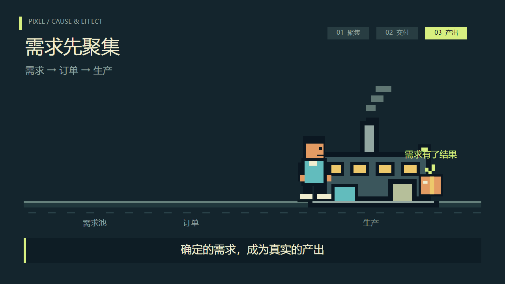

# 像素动画代码创作

用 Canvas 绘图、绝对时间采样和逐帧编码制作可编辑的像素风解释动画。仓库包含一个完整静音样例、导出与拆帧工具，以及可选的创作方法 Skill；不需要调用模型 API。



图为本仓库虚构样例第 170 帧的实际输出，使用系统中文字体。

## 亮点

- 绘图、动作和场景编排分层；拖动或乱序寻帧时重新计算状态。
- 内置“需求聚集 → 订单交付 → 产品产出”的虚构样例。
- 导出检查寻帧一致性、帧数、尺寸及完整解码。
- 拆帧保留源时间戳，并排比较支持偏移与明确选择的音轨。
- 默认静音，拒绝覆盖已有输出，不捆绑参考视频、音频或字体。

## 前置条件

Python 3.10+、Node.js 22.12+、本机 Chrome/Chromium 或 Edge，PATH 中的 FFmpeg 与 ffprobe。拆帧联系表和对比标签需要 Pillow。视频编码需要 FFmpeg 的 libx264 编码器。输出文件系统需支持同卷硬链接。

## 安装与运行

从仓库根目录执行，下列 `demo` 必须是尚不存在的新目录：

```sh
python -m pip install -r requirements.txt
python scripts/bootstrap.py --out demo --title "需求先聚集" --duration 6 --fps 30 --width 1280 --height 720
npm ci --prefix demo
node scripts/render.mjs --project demo --out demo/out/preview.mp4
```

自动探测不到浏览器时，添加 `--chrome <浏览器可执行文件>`。样例使用系统字体，需有中文字体才能显示中文；不同系统的字形可能不同。

预览和编辑：

```sh
python -m http.server 8080 --bind 127.0.0.1 --directory demo
```

打开 `http://127.0.0.1:8080/studio.html`。修改 `demo/config.json` 的标题与字幕，或修改 `demo/src/` 的绘图和时间线。直接双击 HTML 可能无法读取配置。

对你有权处理的视频执行：

```sh
python scripts/extract_frames.py --video demo/out/preview.mp4 --out demo/frames-review --duration 6 --every 15
python scripts/compare.py --reference demo/out/preview.mp4 --candidate demo/out/preview.mp4 --out demo/out/comparison.mp4 --duration 6
```

并排示例使用同一份自产样例验证流程；实际比较时更换输入。默认不带声音；渲染可传 `--audio <音频>`，并排可传 `--audio reference` 或 `--audio candidate`。声音会裁剪或补静音到目标长度，完整旁白应先决定正确时长。

## 目录结构

```text
assets/starter/          可复制的 Canvas 样例
scripts/bootstrap.py    新建项目
scripts/render.mjs      浏览器逐帧绘制与视频编码
scripts/extract_frames.py  带时间戳的帧与联系表
scripts/compare.py      同速并排比较
scripts/runtime.mjs    资源范围与排他发布
scripts/output_paths.py  Python 排他发布
tests/                  合成回归
references/             通用创作、动作设计与验收说明
SKILL.md                可选代理使用说明
```

可在新任务附上 `SKILL.md` 使用方法说明；如需安装，按你的代理环境将整个仓库复制到个人技能目录，不覆盖已有同名 Skill。

## 验证方式

```sh
python -m unittest discover -s tests -p "test_*.py" -v
node --test tests/runtime.test.mjs
```

另用上面的样例导出、拆帧和并排命令检查真实媒体路径。回归使用虚构输入，验证输出保护、参数与时间线规则；不代表自动评价美术质量或叙事效果。

本次验证：14 项回归通过；6 秒、1280×720、30 fps 的静音与合成音调样例均导出成功，180 帧和乱序寻帧检查通过；抽取 12 帧时间戳一致，带音轨并排成片完整解码通过。没有使用他人的视频或声音做测试。

## 已知限制

- 样例是现代像素风代码演示，不保证严格低分辨率、固定色板或所有变换落在整数像素网格上。
- 它不会自动把任意文章转换成成片；新文案需要重新编排人物、动作、字幕和时间。
- 检查点寻帧一致不等于所有帧或剧情正确；仍需原速观看和听音。
- 失败可能保留帧目录或部分输出。多个输出文件不是整体事务；检查后换新名称重试，不自动清理用户文件。
- 静态服务只供本机可信项目使用；动画 JavaScript 会在浏览器执行，不提供对恶意项目的安全隔离。
- 拆帧会读取全片时间戳，长视频可能消耗较多内存；只保留必要帧与结果。

## 来源日期与许可证 / 所有权

源工具与通用样例于 2026-10-24 在作者个人创作任务中编写；独立整理日期为 2026-10-25。公开副本移除了私人案例、参考片测量数据、参考音轨、字体素材与本机路径，并补充了输出保护和验证。

代码未附带明确的开源许可证，本仓库不擅自新增许可证。公开可见不等于授予任意复制、修改或再分发许可。Puppeteer、Pillow、浏览器和 FFmpeg 是使用者另行安装的依赖，各自遵循原项目许可证；仓库没有复制它们的源码或二进制文件。
